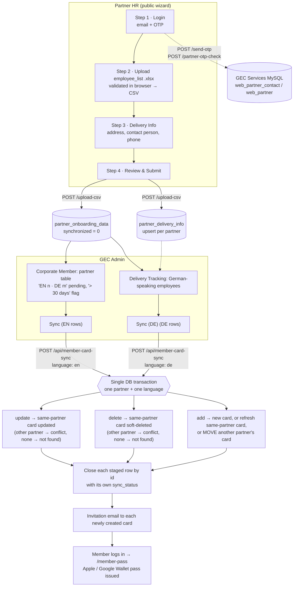

# Partner Onboarding: Employee List Submission & Synchronization

Source files: `routes/partner_onboarding.js`, `routes/member_card.js`, `routes/otp.js` (partner login),
`public/src/components/PartnerOnboarding/PartnerOnboarding.tsx`,
`public/src/components/PartnerOnboarding/validateAndConvertXlsx.tsx`,
`public/src/components/Sections/MemberCardDataGrid.jsx`,
`public/src/components/Sections/DeliveryTrackingSection.jsx`.

---

## 1. High-Level Workflow



**In one paragraph:** A partner company's HR contact logs into the onboarding wizard with an OTP
sent to their email, which must belong to an active partner contact in GEC Services. They upload an
Excel employee list that is validated in the browser, enter delivery details, and submit. The
employees land in a **staging table** (`partner_onboarding_data`), not in the live membership
table. A GEC admin then reviews the pending count per partner and language. They press **Sync** in
the Corporate Member section for English-speaking employees, and **Sync (DE)** in Delivery Tracking
for German-speaking ones. In one transaction, sync applies each staged row's action (add, update or
delete) to `member_card`, assigns card numbers and expiry dates to new members, closes every staged
row with its own outcome, and emails invitations to the new members. Those members then log in to
claim their digital wallet pass.

---

## 2. Business Description

### 2.1 Purpose

GEC offers corporate membership cards to employees of partner companies. Maintaining these
memberships by hand does not scale, so partners maintain their own employee roster. HR uploads a
spreadsheet of who joins, changes or leaves, and GEC applies those changes in a controlled step.

The process has two deliberately separate phases:

| Phase | Owner | Effect |
|---|---|---|
| **Submission** | Partner HR | Data is *staged* only. Nothing changes for members yet. |
| **Synchronization** | GEC admin | Staged changes are applied to live membership cards. |

Keeping the phases separate gives GEC a review gate. A bad upload never reaches live cards until
an admin syncs it, and every live change can be traced to a staged row.

### 2.2 Actors

| Actor | Role |
|---|---|
| **Partner HR contact** | Must exist as an active contact (`web_partner_contact` joined to `web_partner.status = '1'`) in GEC Services. Submits the employee list. |
| **GEC admin** | Signed-in admin (all `/api/*` routes pass `authorize_admin` and the full-tier check in `server.js`). Reviews and syncs. |
| **Employee / member** | Receives an invitation email, logs in, and gets a Corporate Card wallet pass. |

### 2.3 Card types

| `member_card.type` | Meaning | Assigned when | Card number range |
|---|---|---|---|
| `7` | Corporate (red) | Employee language `en` | `7000001…` |
| `5` | Blue (non-paid) | Employee language `de` | `5000001…` |
| `1` | Blue (paid) | Not produced by this flow | — |

New cards are valid for **1 year** from synchronization (`card_expiry_date = now + 1 year`).

### 2.4 Business rules at a glance

- An employee is identified by **mobile number**, not email. Phones are stored as country code
  and digits only (`971501234567`), in staging and on cards.
- Each row in the upload says what should happen to that employee: **Add**, **Update** or **Delete**.
- Delete is always a **soft delete** (`active = 0`). History is never removed.
- Pending rows **never expire**. A partner with rows older than 30 days is flagged.
- Each employee has at most **one pending row** per partner. A re-upload replaces it, and the old
  row is kept as `superseded`.
- English and German rows are synced **separately** (Corporate Member and Delivery Tracking).
- An employee who already holds an active card with **this partner** and was synced for this
  partner in the last 3 months is not re-added.
- An **add** for a phone that belongs to another partner's card **moves** the card (the employee
  changed jobs). An **update** or **delete** never changes another partner's card; it is reported
  as a conflict.
- Delivery info (address, contact person, phone) is stored once per partner and overwritten on each
  submission. It is used to deliver physical cards to German-speaking employees.

---

## 3. Phase 1: Partner Employee List Submission

### 3.1 Wizard steps (`PartnerOnboarding.tsx`)

| # | Step | What happens | Gate to continue |
|---|---|---|---|
| 0 | **Login** | `POST /send-otp` with `event = "Partner Onboarding Authentication"` checks the email against GEC Services MySQL and sends an OTP. `POST /partner-otp-check` checks the OTP (production only), signs a 1 h JWT holding the partner record and sets the `partner-usr` httpOnly cookie. On reload, `POST /partner-auto-login` restores the session from that cookie. | Authenticated |
| 1 | **Upload Document** | User drops an `.xlsx` file. `validateAndConvertXlsx` validates it in the browser and converts the valid rows to CSV. Faulty rows are reported and excluded. | ≥ 1 valid row |
| 2 | **Delivery Info** | Pre-filled from `GET /partner-delivery-info?partner=…`. Address, contact person and phone are required, and the phone is checked with `libphonenumber-js`. | All fields valid |
| 3 | **Review Submission** | Summary of the upload. Submit sends `POST /upload-csv` as multipart: the CSV file, `partner` (partner title), `delivery_address`, `contact_person`, `phone_number`. | — |

### 3.2 Excel template requirements (`validateAndConvertXlsx.tsx`)

- The worksheet must be named **`employee_list`**.
- Required headers: `Title`, `First Name`, `Last Name`, `Gender`, `Company Email`, `Mobile Number`,
  `Date of Birth`, `Language`, `Add/Update/Delete`, `Normalized 🔒`.
- Mandatory per row: First Name, Last Name, Company Email, Mobile Number, Language,
  Add/Update/Delete, Normalized 🔒.
- `Normalized 🔒` is a locked, formula-driven phone column. It is cleaned (digits and `+`, leading
  `+` enforced), checked as a valid international number, and checked for duplicates within the file.
- Company Email must match a basic email pattern.
- Rows that fail are returned as `faultyRecords` and left out of the CSV. Valid rows are still submitted.

### 3.3 Server-side staging (`POST /upload-csv`, guarded by `authorize_partner`)

1. The **partner comes from the signed partner session** (`partner-usr` JWT, `partner.title`). A
   `partner` form field is ignored, so one partner cannot stage rows, or card moves, for another.
2. Multer accepts a CSV of up to 5 MB, held in memory.
3. `csv-parse` reads the file using the header row as keys. Keys are lower-cased.
4. Values are sanitized and normalized:
   - `title` ∈ `Mr.`, `Ms.`, `Mrs.`, `Dr.`, `""`. Anything else becomes `""`.
   - `gender` ∈ `m`, `f`, `""`. Anything else becomes `""`.
   - `language` ∈ `en`, `de`. Anything else becomes `en`.
   - `action_type` comes from `Add/Update/Delete` and must be one of `add`, `update`, `delete`.
     Anything else becomes `add`.
   - **Phone**: the validated `Normalized 🔒` value (falling back to `Mobile Number`) goes through
     `normalizePhone`. A row without a usable phone is counted as `invalid` and skipped.
   - **Birthday**: `parseBirthday` accepts `D/M/YYYY`, `DD/MM/YYYY` and `YYYY-MM-DD` and stores
     `YYYY-MM-DD`. Anything else is stored empty. The wizard warns about such rows before
     submission and converts Excel date cells itself.
5. Each row is compared with the employee's current pending row (same partner and phone):
   - **Identical** → counted as `unchanged`, nothing staged.
   - **Different** → the old row is closed as `superseded`, the new row staged (`replaced`).
   - **No pending row** → staged (`inserted`).

   The partial unique index `ux_pod_pending_partner_phone` enforces one pending row per employee.
6. `partner_delivery_info` is upserted on `partner` (unique), in the same transaction as the rows.
7. The response reports `{ total, inserted, replaced, unchanged, skipped (= unchanged), invalid }`.

---

## 4. Phase 2: Synchronization (`POST /api/member-card-sync`)

### 4.1 Admin screen (`MemberCardDataGrid.jsx`, "Corporate Member" section)

- **Left table:** `GET /api/member-card-partner-stats` lists, per partner:
  - the member count, active accounts and wallet passes issued;
  - **Available Update**, shown as `EN n · DE m` (`pending_en`, `pending_de`, all ages);
  - a **"> 30 days"** warning chip when the oldest pending row (`oldest_pending`) is more than 30
    days old.

  Partner names are compared after lower-casing, trimming and folding umlauts (`ü→u`, `ö→o`,
  `ä→a`, `ß→ss`).
- **Right table:** `GET /api/gec-grouped-partners` (MySQL `sp_get_partner_contact_grouped_list`) is
  merged with `GET /api/partner-onboarding-pending-counts`. A "Not in Services" chip marks partners
  missing from GEC Services. A Sync button appears for partners that have pending English rows but
  are not in Services.
- **Sync** sends `{ partner, language: 'en' }` and shows only when `pending_en > 0`. **Sync All** is
  disabled ("Under Development").
- **Sync (DE)** lives in the Delivery Tracking section. It sends `{ partner, language: 'de' }` and is
  disabled while the partner has no pending German rows.
- After either sync, a snackbar summarizes the counts. A dialog lists every card **move** and every
  **conflict**.
- **Resend Invitation** calls `POST /api/resend-membership-email`, which re-emails every active
  member of the partner who has no wallet pass yet (`serial_number IS NULL`). It replies right away
  with `queued` and sends in the background.

### 4.2 Sync algorithm (one SQLite transaction)

**Step 0: Load the batch.** Select every pending staged row (`synchronized != 1`) whose normalized
partner matches and whose language matches the request. There is **no age limit**. Rows of the
other language are not touched. If a phone appears more than once, only the newest row is applied;
the older ones are closed as `superseded`.

**Step 1: Apply each row.** The phone is normalized, every card with that phone is loaded, and the
cards are split into "this partner" and "another partner". The outcome then depends on the action:

| Action | Card of this partner | Only a card of another partner | No card |
|---|---|---|---|
| `update` | Update `firstname`, `lastname`, `title`, `email`, `gender` (`m→Herr`, `f→Frau`, else kept) and `birthday` (empty keeps the card's), set `active = 1` → **synchronized** | Card untouched → **conflict** | **not_found** |
| `delete` | Set `active = 0` → **synchronized** | Card untouched → **conflict** | **not_found** |
| `add` | Refresh details, `type` from language, 1-year expiry, `active = 1` → **synchronized**. Skipped as **already_active** if the card is active and was synced for this partner within 3 months | **Move** the card: set `partner` to the new partner, refresh details, type and expiry, set `active = 1`, and record `moved from <A> to <B> <date>` in `remarks`. Card number and wallet pass are kept → **synchronized** | Insert a card with the next number in the language's range (`7000001…` for `en`, `5000001…` for `de`), type 7 or 5, 1-year expiry → **synchronized** |

**Step 2: Close each row by id.** Every staged row is closed on its own, with `synchronized = 1`,
its `sync_status`, `synced_at` and a `sync_note` (for example `owned by <partner>` or
`moved from <partner>`). No other row is touched, so a sync can never close a row it did not
process.

**After commit:** each newly created card (re-read from `member_card`) gets an invitation
(`membership__invitation`). Invitations go out in batches of 25, 10 s apart. A failed email is
written to `error_log` with its address and does not stop the others.

**Response:** `{ status, inserted, updated, moved, deactivated, superseded, not_found, conflict,
already_active, invitations_queued, moves[], conflicts[] }`. Running the sync again with no new
upload returns all zeros.

### 4.3 From card to wallet pass

The invited member logs in (`POST /member-login` sets the `member-usr` cookie and records
`last_login`). They then call `POST /member-pass`. That call:
- assigns a `memberId` if missing,
- renews an expired card for 1 more year,
- generates a `GEC-…` serial number,
- creates the Apple `.pkpass` and Google Wallet pass,
- emails the pass links.

### 4.4 Delivery tracking (German-speaking employees)

`DeliveryTrackingSection.jsx` lists partners that have delivery info
(`/api/partners-with-delivery`). It shows each partner's address and contact
(`/api/partner-delivery-info`) and their `language = 'de'` staged employees
(`/api/partner-delivery-employees`, with an unsynced/synced toggle) for physical card delivery.
Its **Sync (DE)** button applies that partner's pending German rows (blue cards, `5…` numbers).
German rows stay listed as pending until then. The English sync never closes them.

### 4.5 Manual maintenance (bypasses staging)

From the Corporate Members grid, admins can edit `member_card` directly:

| Endpoint | Effect |
|---|---|
| `POST /api/partner-onboarding/employee` | Insert a card, `remarks = 'manually added'` |
| `PUT /api/partner-onboarding/employee/:id` | Update a card |
| `DELETE /api/partner-onboarding/employee/:id` | Soft-delete a card |

---

## 5. Data Model

```
partner_onboarding_data  (staging, append-only)
  id, title, firstname, lastname, gender(m/f/''), mobile_number (digits only), email,
  partner (from the partner JWT), birthday (YYYY-MM-DD or NULL), language(en/de),
  action_type(add/update/delete), metadata_createdAt,
  synchronized (0 = pending, 1 = closed),
  sync_status (pending | synchronized | superseded | not_found | conflict | already_active),
  synced_at, sync_note
  UNIQUE (LOWER(TRIM(partner)), mobile_number) WHERE synchronized = 0

partner_delivery_info    (one row per partner, overwritten per submission)
  partner UNIQUE, delivery_address, contact_person, phone_number, created_at, updated_at

member_card              (live memberships)
  id, partner, mobile_number, firstname, lastname, title, gender(Herr/Frau),
  email, birthday, active, type(7/5/1), card_number, card_expiry_date,
  memberId, serial_number, google_pass_token, remarks, last_login,
  metadata_createdAt, metadata_modifiedAt
```

Records are joined on `partner_onboarding_data.mobile_number = member_card.mobile_number`.

---

## 6. Endpoint Reference

| Method & path | Auth | Purpose |
|---|---|---|
| `POST /send-otp` | rate-limited | Check partner email in GEC Services and send OTP |
| `POST /partner-otp-check` | — | Verify OTP and set `partner-usr` cookie (1 h) |
| `POST /partner-auto-login` | partner | Restore wizard session |
| `GET /partner-delivery-info` | partner | Pre-fill delivery step |
| `POST /upload-csv` | partner | Stage employees and upsert delivery info |
| `GET /api/partner-onboarding` | admin | Staged rows grid (unsynced by default) |
| `GET /api/member-card-partner-stats` | admin | Per-partner counts and pending updates |
| `GET /api/gec-grouped-partners` | admin | Partners from GEC Services |
| `GET /api/partner-onboarding-pending-counts` | admin | Pending rows per partner |
| `POST /api/member-card-sync` | admin | Apply staged changes to `member_card` |
| `POST /api/resend-membership-email` | admin | Re-send invitations to members without a pass |
| `GET /api/partner-delivery-employees` | admin | German-speaking staged employees |
| `GET /api/partner-delivery-info`, `GET /api/partners-with-delivery` | admin | Delivery tracking |
| `POST/PUT/DELETE /api/partner-onboarding/employee[/:id]` | admin | Manual card maintenance |

---

## 7. Issues Found & Resolved (feature 016)

These issues were found while reading the code and fixed in `specs/016-fix-partner-sync`.

| # | Issue | Resolution |
|---|---|---|
| 1 | Sync invitations were never sent: a `Set` was passed to `chunkArray`, which needs `.length`. One failed email also aborted every later batch. | Sync passes an array of the newly created `member_card` rows. `sendBatchEmails` accepts any iterable, uses `Promise.allSettled` and logs each failure to `error_log`. |
| 2 | The final step closed **all** of the partner's pending rows, so whichever language synced first closed the other language's rows unapplied. (The earlier claim here that the UI only ever sent `en` was wrong: Delivery Tracking already had "Sync (DE)".) | Each staged row is closed by id with its own `sync_status`. A sync never touches rows of the other language. The partner table shows EN and DE counts, and "Sync (DE)" is disabled when nothing is pending. |
| 3 | Older duplicates for the same phone were marked synchronized although never applied. | They are closed as `superseded`, and both sync and upload report them. |
| 4 | `add` stripped the `+` before matching, but `update` and `delete` did not. | One `normalizePhone` helper is used at upload and for every action at sync. The migration converted existing pending rows. |
| 5 | The server stored the raw `Mobile Number` instead of the validated `Normalized 🔒` value. | `Normalized 🔒` is stored, normalized. |
| 6 | The birthday conversion was computed but not stored, and the wizard dropped Excel date cells. | The wizard converts date cells (UTC) and warns about unreadable dates. The server stores `parseBirthday` output, and an empty birthday never overwrites a card. |
| 7 | An `add` for another partner's phone overwrote that card while it kept the old partner. | The card **moves** to the new partner (number and pass kept, move recorded in `remarks`, `sync_note` and the sync result). Update and delete across partners are conflicts. The upload takes the partner from the JWT, so the form can't choose it. |
| 8 | `INSERT OR IGNORE` never ignored anything, so re-uploads staged duplicates and `skipped` was always 0. | A re-upload replaces the pending row (old one `superseded`), and identical rows are `unchanged`. A partial unique index enforces one pending row per employee. |
| 9 | Pending rows older than one month silently disappeared. | There is no age limit. Partners with rows older than 30 days are flagged with the oldest date. |

**Schema:** `sql_files/create_tables.sql` now carries `sync_status`, `synced_at`, `sync_note` and
`ux_pod_pending_partner_phone`, and its stray `;` is fixed. Existing databases are updated with
`sql_files/migrate_partner_onboarding_sync_status.sql`, which must run **before** deploying the 016 code.

**Still open (out of scope):**
- `GET /partner-delivery-info` still reads the partner from the query string. It only reads
  delivery info, but should also use the JWT.
- A moved card's `remarks` are overwritten by its next sync. The move stays recorded on the staged
  row's `sync_note`.
- Rows wrongly closed before 016 (one German row in the local DB) were not re-opened. HR can
  re-submit them.
